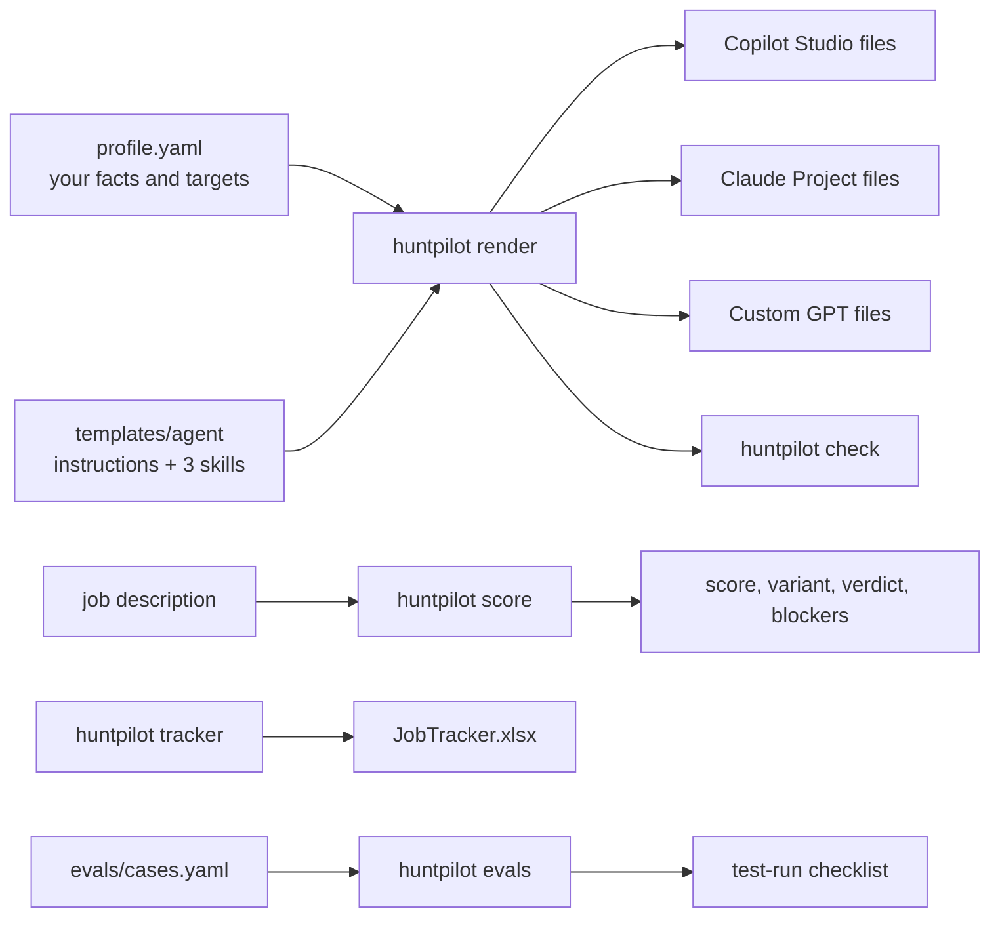

# HuntPilot

**A referral-first AI job search copilot.** It finds roles, scores your fit, writes tailored resumes and cover letters, asks for a referral before you apply cold, and keeps your tracker up to date. It drafts everything and sends nothing.

HuntPilot is a set of agent templates plus a small TypeScript CLI. You fill in one profile file and render paste-ready files for **Microsoft Copilot Studio**, a **Claude Project** or a **custom GPT**.

[](https://github.com/JawadulHadi/job_hunt/actions/workflows/ci.yml)


## What it does

| Mode | What you get |
| --- | --- |
| Find jobs | Fresh roles from company boards (Greenhouse, Lever, Ashby) and remote boards, opened, scored and de-duplicated against your tracker |
| Analyse a JD | Requirement-by-requirement fit table, a 0–100 score, the resume variant to use, and a verdict: Apply, Referral first or Skip |
| Hard filters | Skips roles you can't take (work authorization, onsite only, unpaid trials) and quotes the line that blocks you |
| Tailor | Resume bullets reordered for the role, from your facts only, in an ATS-safe single column |
| Referral first | Finds a warm route in (maintainers, blog authors, community members) and drafts a 90-word ask |
| Write | Cover letters capped at 250 words with your one headline metric, word for word |
| Interview prep | Likely questions, STAR outlines from your real experience, and mock interviews one question at a time |
| Tracker | Logs and updates an Excel table with stable IDs, statuses and follow-up dates |

## How it fits together



The agent does the reading and writing. The CLI keeps the setup consistent: one profile, the same facts on every platform, and a deterministic pre-score you can run on any job description.

## Quick start

Requires Node.js 20 or newer.

```bash
git clone https://github.com/JawadulHadi/job_hunt.git
cd job_hunt
npm install

cp examples/profile.example.yaml profile.yaml   # git-ignored; edit it with your own facts
npm run render                                   # writes out/<platform>/
npm run check                                    # unfilled placeholders, banned words, length limits
npm run tracker                                  # writes out/JobTracker.xlsx
npm run evals                                    # writes out/test-run.md
npm run score -- path/to/job-description.txt     # pre-score one JD
```

Then follow the setup guide for your platform:

- [Microsoft Copilot Studio](docs/setup-copilot-studio.md)
- [Claude Project](docs/setup-claude-project.md)
- [Custom GPT](docs/setup-custom-gpt.md)

## Scoring a job description

```text
$ npm run score -- tests/fixtures/jd-us-only.txt
Score: 75/100   Verdict: Skip   Variant: C

| Area | Points | Matched |
| --- | --- | --- |
| Core stack | 30/30 | nestjs, typescript, postgresql |
| Seniority | 20/20 | staff |
| AI / LLM | 0/15 | none |
| Supporting stack | 10/10 | graphql, redis |
| Remote fit | 15/15 | remote |
| Company signal | 0/10 | none |

Blockers:
- Requires US work authorization: "Candidates must be authorized to work in the United States."
```

A 75 would normally be Apply. The work-authorization line turns it into Skip, before you spend time tailoring.

The rubric, thresholds and hard filters all live in your profile. See [docs/fit-scoring.md](docs/fit-scoring.md).

## Test before you trust it

Run the 14 cases in [evals/cases.yaml](evals/cases.yaml) against your deployed agent with your own resume and real job descriptions. `npm run evals` turns them into a checklist with your details filled in. Go live only when every critical case passes. See [docs/testing.md](docs/testing.md).

## Safety rules built in

- Drafts only. It never sends email or messages, and never submits applications.
- It never overwrites your resume or any file it didn't create.
- It never invents employers, dates, metrics or certifications. Missing facts go to a "Needs your input" list.
- It won't guarantee legal, immigration, tax or salary outcomes.

**Keep your configured agent private.** It holds your resume and can reach your files and email. Share this template, not your instance. See [docs/publishing.md](docs/publishing.md).

## Repository layout

```text
templates/agent/   instructions, skills and prompts with {{profile.tokens}}
examples/          a fictional example profile
evals/             test cases
src/               the huntpilot CLI (TypeScript)
tests/             unit tests (Vitest)
docs/              setup, scoring, testing and publishing guides
```

## Contributing

Issues and pull requests are welcome. See [CONTRIBUTING.md](CONTRIBUTING.md).

## License

[MIT](LICENSE) © 2026 Jawad Ul Hadi
